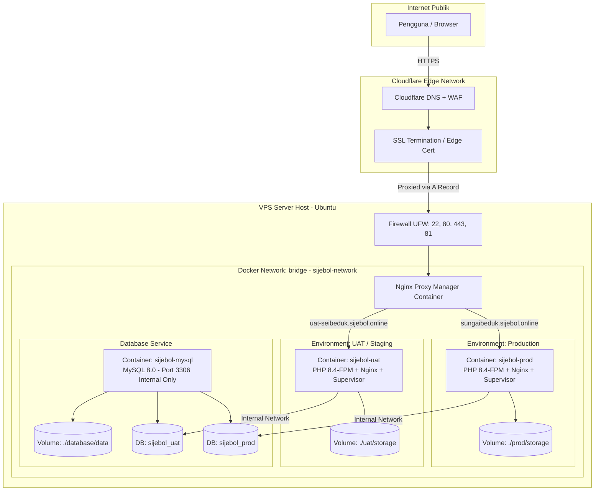

# Standard Deployment Guide & Architecture Playbook

Dokumen ini adalah standar arsitektur, workflow, struktur folder, dan panduan langkah demi langkah (*step-by-step playbook*) untuk melakukan deployment aplikasi Laravel modern (Inertia.js / Vue / React / Blade) ke lingkungan VPS menggunakan Docker, Nginx Proxy Manager, dan Cloudflare.

Dokumen ini dirancang agar **pengembang manusia maupun AI agent di sesi mendatang** dapat memahami, mereplikasi, dan mengelola alur deployment dengan konsisten, aman, dan tanpa *trial-and-error*.

---

## 1. Topologi & Arsitektur Sistem

Arsitektur ini menerapkan prinsip **Zero Public Database Exposure**, **Multi-Environment Isolation (Production & UAT dalam 1 VPS)**, dan **Reverse Proxy Terpadu**.



---

## 2. Resource Sizing & Kapasitas Server

Sebagai acuan standar untuk VPS skala UKM / Pemerintahan (contoh: **2 vCPU, 4 GB RAM, 80 GB SSD**):

| Service / Container | Alokasi RAM Rata-Rata | Catatan Konfigurasi |
|---|---|---|
| **OS Ubuntu + Docker Daemon** | ~400 – 500 MB | Base system overhead |
| **Nginx Proxy Manager (NPM)** | ~100 – 150 MB | Reverse proxy, Let's Encrypt SSL manager |
| **MySQL 8.0 (`sijebol-mysql`)** | ~600 – 750 MB | Di-tuning: `--innodb-buffer-pool-size=512M` |
| **Aplikasi Production (`sijebol-prod`)** | ~350 – 450 MB | PHP 8.4-FPM + Nginx + Worker (`queue:work`) |
| **Aplikasi UAT (`sijebol-uat`)** | ~250 – 350 MB | PHP 8.4-FPM + Nginx + Worker (`queue:work`) |
| **Total Estimasi Terpakai** | **~1.8 – 2.2 GB** | **Sisa ~1.8 GB aman untuk OS page cache & burst traffic** |

---

## 3. Standar Struktur Folder di Server VPS

Seluruh komponen aplikasi dipusatkan di direktori `/opt/<nama_project>` untuk kemudahan *backup*, isolasi, dan manajemen hak akses:

```text
/opt/sijebol/
├── npm/                         # Nginx Proxy Manager
│   ├── docker-compose.yml       # Port 80, 443, dan 81
│   ├── data/                    # Konfigurasi Nginx proxy hosts & SQLite internal
│   └── letsencrypt/             # Sertifikat SSL Let's Encrypt
│
├── database/                    # Database MySQL 8.0 Terpadu
│   ├── docker-compose.yml       # Tanpa port binding publik (internal network only)
│   ├── init/
│   │   └── 01-init.sql          # Inisialisasi DB prod & uat + GRANT privileges
│   └── data/                    # Persistent storage database MySQL
│
├── prod/                        # Lingkungan Production
│   ├── storage/                 # Persistent storage (KK, Akta, logs)
│   └── app/                     # Git clone dari branch `main`
│       ├── .env                 # Konfigurasi production
│       ├── Dockerfile
│       └── docker-compose.prod.yml
│
├── uat/                         # Lingkungan UAT / Staging
│   ├── storage/                 # Persistent storage UAT
│   └── app/                     # Git clone dari branch `staging`
│       ├── .env                 # Konfigurasi UAT
│       ├── Dockerfile
│       └── docker-compose.uat.yml
│
├── deploy-prod.sh               # Shortcut deploy prod -> /usr/local/bin/deploy-prod
└── deploy-uat.sh                # Shortcut deploy uat -> /usr/local/bin/deploy-uat
```

---

## 4. Alur Percabangan Git (Branching Workflow)

* **Branch `main`**: Digunakan untuk **Production** (`sungaibeduk.sijebol.online`).
* **Branch `staging`**: Digunakan untuk **UAT** (`uat-seibeduk.sijebol.online`).

```
[Laptop Dev] feature/xxx ──► merge ke `staging` ──► push origin staging
                                                          │
                                                    (Deploy ke UAT)
                                                          │
                                                    (Verifikasi UAT)
                                                          │
[Laptop Dev] merge `staging` ke `main` ──────────► push origin main
                                                          │
                                                    (Deploy ke Production)
```

---

## 5. Panduan Instalasi Awal (Step-by-Step Playbook)

### Langkah 1: Persiapan DNS di Cloudflare
1. Buka DNS Management domain di Cloudflare.
2. Tambahkan **A Record** (Mode: **Proxied / Awan Oranye**):
   * `sungaibeduk` ➔ `IP_PUBLIK_VPS`
   * `uat-seibeduk` ➔ `IP_PUBLIK_VPS`
3. Pengaturan SSL/TLS Cloudflare:
   * **SSL/TLS Mode**: **Full** (wajib, jangan *Flexible* agar tidak redirect loop).
   * **Always Use HTTPS**: **ON**.
   * **Minimum TLS Version**: **TLS 1.2**.

---

### Langkah 2: Setup Awal VPS (Ubuntu)
Masuk via SSH ke VPS:
```bash
# 1. Update paket sistem
apt update && apt upgrade -y
apt install -y curl git ufw htop

# 2. Pasang Docker Engine resmi
curl -fsSL https://get.docker.com -o get-docker.sh
sh get-docker.sh

# 3. Setup Firewall UFW (PENTING: izinkan SSH dulu!)
ufw allow 22/tcp
ufw allow 80/tcp
ufw allow 443/tcp
ufw allow 81/tcp
ufw enable

# 4. Buat Docker Network bersama
docker network create sijebol-network
```

---

### Langkah 3: Menjalankan Nginx Proxy Manager (NPM)
```bash
mkdir -p /opt/sijebol/npm && cd /opt/sijebol/npm

cat << 'EOF' > docker-compose.yml
services:
  npm:
    image: 'jc21/nginx-proxy-manager:latest'
    container_name: nginx-proxy-manager
    restart: unless-stopped
    ports:
      - '80:80'
      - '81:81'
      - '443:443'
    volumes:
      - ./data:/data
      - ./letsencrypt:/etc/letsencrypt
    networks:
      - sijebol-network

networks:
  sijebol-network:
    external: true
EOF

docker compose up -d
```
* Buka browser: `http://<IP_VPS>:81`
* Login awal: `admin@example.com` / `changeme` (segera ganti email & password).

---

### Langkah 4: Menjalankan Database MySQL 8.0
```bash
mkdir -p /opt/sijebol/database/init && cd /opt/sijebol/database

# Buat file inisialisasi SQL
cat << 'EOF' > init/01-init.sql
CREATE DATABASE IF NOT EXISTS sijebol_prod CHARACTER SET utf8mb4 COLLATE utf8mb4_unicode_ci;
CREATE DATABASE IF NOT EXISTS sijebol_uat CHARACTER SET utf8mb4 COLLATE utf8mb4_unicode_ci;
GRANT ALL PRIVILEGES ON sijebol_prod.* TO 'sijebol'@'%';
GRANT ALL PRIVILEGES ON sijebol_uat.* TO 'sijebol'@'%';
FLUSH PRIVILEGES;
EOF

# Buat docker-compose.yml
cat << 'EOF' > docker-compose.yml
services:
  mysql:
    image: 'mysql:8.0'
    container_name: sijebol-mysql
    restart: unless-stopped
    environment:
      MYSQL_ROOT_PASSWORD: 'PasswordRootKuat123!'
      MYSQL_USER: 'sijebol'
      MYSQL_PASSWORD: 'PasswordSijebolKuat123!'
    command:
      - --default-authentication-plugin=mysql_native_password
      - --character-set-server=utf8mb4
      - --collation-server=utf8mb4_unicode_ci
      - --innodb-buffer-pool-size=512M
      - --max-connections=100
    volumes:
      - ./data:/var/lib/mysql
      - ./init:/docker-entrypoint-initdb.d
    networks:
      - sijebol-network

networks:
  sijebol-network:
    external: true
EOF

docker compose up -d
```

---

### Langkah 5: Deploy Environment Production

```bash
mkdir -p /opt/sijebol/prod && cd /opt/sijebol/prod
git clone -b main https://github.com/abdlazz00/sijebol.git app
cd app
cp .env.production.example .env

# Edit .env (isi DB_PASSWORD dan RESEND_API_KEY)
nano .env

# Jalankan build container
docker compose -f docker-compose.prod.yml up -d --build

# Generate APP_KEY dan simpan ke file .env host
KEY=$(docker exec sijebol-prod php artisan key:generate --show)
sed -i "s|^APP_KEY=.*|APP_KEY=$KEY|" .env
docker compose -f docker-compose.prod.yml up -d

# Seeding & buat Super Admin pertama
docker exec -it sijebol-prod php artisan db:seed
docker exec -it sijebol-prod php artisan sijebol:create-super-admin admin@sungaibeduk.go.id "Super Admin"
```

---

### Langkah 6: Routing & SSL di Nginx Proxy Manager (NPM)

1. Buka dashboard NPM (`http://<IP_VPS>:81`) ➔ **Hosts** ➔ **Proxy Hosts** ➔ **Add Proxy Host**.
2. **Tab Details**:
   * **Domain Names**: `sungaibeduk.sijebol.online`
   * **Scheme**: `http`
   * **Forward Hostname / IP**: `sijebol-prod`
   * **Forward Port**: `80`
   * Aktifkan: `Block Common Exploits` & `Websockets Support`.
3. **Tab SSL**:
   * **SSL Certificate**: `Request a new SSL Certificate`.
   * Aktifkan: `Force SSL` & `HTTP/2 Support`.
   * Isi email & centang persetujuan Let's Encrypt.
4. **Tab Ikon Gerigi (⚙️ / Advanced)**:
   > [!IMPORTANT]
   > Wajib ditambahkan untuk mencegah error **502 Bad Gateway** akibat header keamanan CSP & Inertia yang melebihi batas buffer default Nginx:
   ```nginx
   proxy_buffer_size 128k;
   proxy_buffers 4 256k;
   proxy_busy_buffers_size 256k;
   ```
5. Klik **Save**.

---

### Langkah 7: Deploy Environment UAT
Ulangi alur di atas untuk folder `/opt/sijebol/uat`:
* Clone dari branch `staging`.
* Gunakan `.env.uat.example` (database: `sijebol_uat`).
* Jalankan `docker compose -f docker-compose.uat.yml up -d --build`.
* Di NPM arahkan `uat-seibeduk.sijebol.online` ➔ `sijebol-uat:80` dengan tab gerigi ⚙️ buffer yang sama.

---

## 6. Otomasi Deployment Harian (Daily Deploy Commands)

Pasang shortcut di VPS (cukup sekali):
```bash
ln -sf /opt/sijebol/prod/app/scripts/deploy-prod.sh /usr/local/bin/deploy-prod
ln -sf /opt/sijebol/uat/app/scripts/deploy-uat.sh /usr/local/bin/deploy-uat
```

Setiap kali ada fitur baru atau perubahan kolom database:
* **Update UAT**: cukup jalankan `deploy-uat`
* **Update Prod**: cukup jalankan `deploy-prod`

Isi proses otomatis yang dijalankan oleh script ini:
1. `git pull origin <branch>`
2. `docker compose ... up -d --build` (kompilasi Vite & instalasi dependensi)
3. `php artisan migrate --force` (otomatis lewat entrypoint container)
4. `php artisan queue:restart` (merestart background worker)
5. `php artisan config:cache && route:cache && view:cache` (optimasi cache produksi)

---

## 7. Troubleshooting Playbook (Penyelesaian Masalah Cepat)

### Kasus 1: Port 22 SSH Connection Timed Out setelah UFW aktif
* **Gejala**: Tidak bisa login via SSH dari terminal laptop.
* **Solusi**: Masuk ke **VNC / Web Console** di panel hosting VPS (Rumahweb). Jalankan:
  ```bash
  ufw disable
  ufw allow 22/tcp
  systemctl restart ssh
  ```

### Kasus 2: Error "Composer dependencies require PHP >= 8.4.1"
* **Gejala**: Container crash dengan error platform check saat artisan dijalankan.
* **Penyebab**: Paket Symfony/Laravel terbaru di `composer.lock` membutuhkan PHP 8.4+.
* **Solusi**: Gunakan base image `php:8.4-fpm-bookworm` di `Dockerfile`.

### Kasus 3: Error "No application encryption key has been specified"
* **Gejala**: Seeder atau migrasi gagal saat enkripsi dijalankan.
* **Penyebab**: `APP_KEY` di file `.env` host masih kosong saat docker compose dijalankan.
* **Solusi**:
  ```bash
  KEY=$(docker exec <container_name> php artisan key:generate --show)
  sed -i "s|^APP_KEY=.*|APP_KEY=$KEY|" .env
  docker compose -f <compose_file> up -d
  ```

### Kasus 4: Error "502 Bad Gateway / upstream sent too big header"
* **Gejala**: Akses ke `/login` atau route yang mengirim header CSP mengembalikan error 502.
* **Penyebab**: Header Content-Security-Policy (CSP) + Cookie + Inertia melebihi buffer default FastCGI (4k) dan Proxy buffer NPM.
* **Solusi**:
  1. Di `docker/nginx.conf` tambahkan:
     ```nginx
     fastcgi_buffer_size 64k;
     fastcgi_buffers 8 64k;
     fastcgi_busy_buffers_size 128k;
     ```
  2. Di NPM (Tab gerigi ⚙️ Advanced) tambahkan:
     ```nginx
     proxy_buffer_size 128k;
     proxy_buffers 4 256k;
     proxy_busy_buffers_size 256k;
     ```

### Kasus 5: Error "Cannot find module vendor/tightenco/ziggy" saat npm run build
* **Gejala**: Docker multi-stage build gagal pada tahap `vue-tsc && vite build`.
* **Penyebab**: Folder `vendor` diabaikan oleh `.dockerignore`.
* **Solusi**: Jalankan Composer install di stage 1 Dockerfile, lalu salin `vendor/tightenco/ziggy` ke stage frontend sebelum mengeksekusi `npm run build`.
