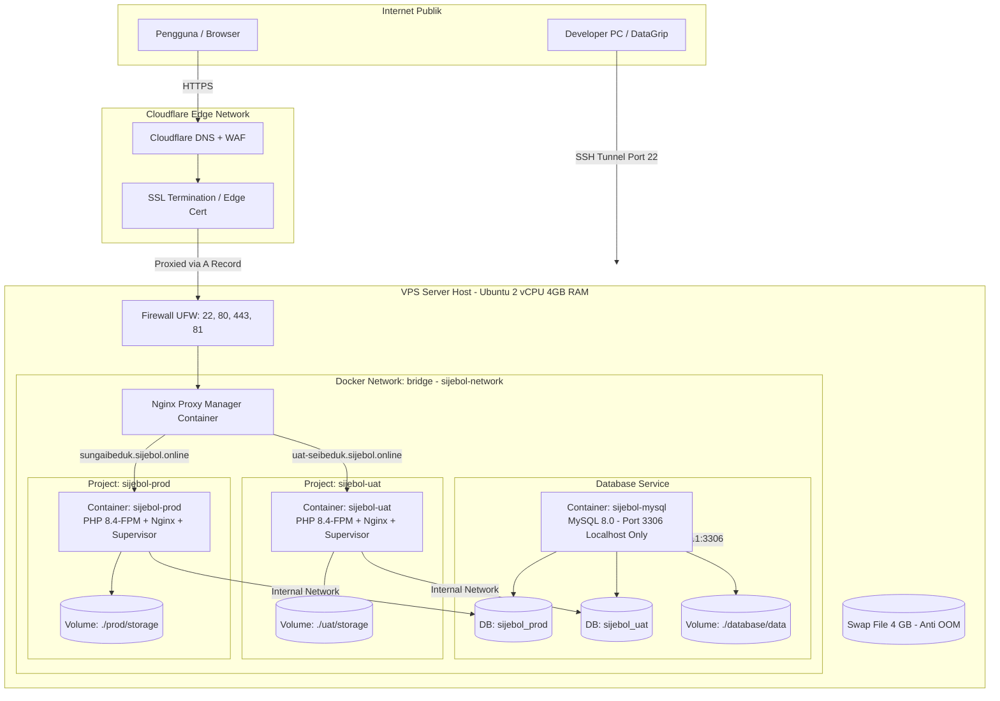

# Standard Deployment Guide & Architecture Playbook

Dokumen ini adalah standar arsitektur, workflow, struktur folder, dan panduan langkah demi langkah (*step-by-step playbook*) untuk melakukan deployment aplikasi Laravel modern (Inertia.js / Vue / React / Blade) ke lingkungan VPS menggunakan Docker, Nginx Proxy Manager, dan Cloudflare.

Dokumen ini dirancang agar **pengembang manusia maupun AI agent di sesi mendatang** dapat memahami, mereplikasi, dan mengelola alur deployment dengan konsisten, aman, dan tanpa *trial-and-error*.

---

## 1. Topologi & Arsitektur Sistem

Arsitektur ini menerapkan prinsip **Zero Public Database Exposure**, **Multi-Environment Isolation (Production & UAT dalam 1 VPS)**, dan **Reverse Proxy Terpadu**.



---

## 2. Resource Sizing & Kapasitas Server

Sebagai acuan standar untuk VPS skala UKM / Pemerintahan (contoh: **2 vCPU, 4 GB RAM, 80 GB SSD**):

| Service / Komponen | Alokasi RAM Rata-Rata | Catatan Konfigurasi |
|---|---|---|
| **OS Ubuntu + Docker Daemon** | ~400 – 500 MB | Base system overhead |
| **Nginx Proxy Manager (NPM)** | ~100 – 150 MB | Reverse proxy, Let's Encrypt SSL manager |
| **MySQL 8.0 (`sijebol-mysql`)** | ~600 – 750 MB | Di-tuning: `--innodb-buffer-pool-size=512M` |
| **Aplikasi Production (`sijebol-prod`)** | ~350 – 450 MB | PHP 8.4-FPM + Nginx + Worker (`queue:work`) |
| **Aplikasi UAT (`sijebol-uat`)** | ~250 – 350 MB | PHP 8.4-FPM + Nginx + Worker (`queue:work`) |
| **Swap File Linux** | **4.0 GiB (Wajib)** | **Pencegah OOM Killer saat `npm run build` (Vite) berjalan** |
| **Total RAM Terpakai (Idle)** | **~1.8 – 2.2 GB** | **Sisa ~1.8 GB aman untuk OS page cache & burst traffic** |

> [!CRITICAL]
> **Wajib Membuat Swap 4 GB**:
> Saat deploy, proses kompilasi aset frontend (`npm run build` / `vue-tsc`) membutuhkan lonjakan RAM 1.5–2 GB. Tanpa Swap, Linux OOM (Out Of Memory) Killer akan membunuh container Production atau MySQL (`Exit Code 137`), menyebabkan 503 Bad Gateway.

---

## 3. Standar Struktur Folder di Server VPS

Seluruh komponen aplikasi dipusatkan di direktori `/opt/<nama_project>` untuk kemudahan *backup*, isolasi, dan manajemen hak akses:

```text
/opt/sijebol/
├── npm/                         # Nginx Proxy Manager
│   ├── docker-compose.yml       # Port 80, 443, dan 81
│   ├── data/                    # Konfigurasi Nginx proxy hosts & SQLite internal
│   └── letsencrypt/             # Sertifikat SSL Let's Encrypt
│
├── database/                    # Database MySQL 8.0 Terpadu
│   ├── docker-compose.yml       # Port 127.0.0.1:3306:3306 (Localhost only untuk DataGrip)
│   ├── init/
│   │   └── 01-init.sql          # Inisialisasi DB prod & uat + GRANT privileges
│   └── data/                    # Persistent storage database MySQL
│
├── prod/                        # Lingkungan Production
│   ├── storage/                 # Persistent storage (KK, Akta, logs)
│   └── app/                     # Git clone dari branch `main`
│       ├── .env                 # COMPOSE_PROJECT_NAME=sijebol-prod
│       ├── Dockerfile
│       └── docker-compose.prod.yml
│
└── uat/                         # Lingkungan UAT / Staging
    ├── storage/                 # Persistent storage UAT
    └── app/                     # Git clone dari branch `staging`
        ├── .env                 # COMPOSE_PROJECT_NAME=sijebol-uat
        ├── Dockerfile
        └── docker-compose.uat.yml
```

> [!IMPORTANT]
> **Isolasi Project Namespace (Pencegah Container Saling Timpa)**:
> Karena folder aplikasi Prod dan UAT sama-sama bernama `app` (`/opt/sijebol/prod/app` dan `/opt/sijebol/uat/app`), Docker Compose secara default akan menamai project keduanya sebagai `app`. 
> Jika tidak diisolasi, menjalankan deploy di UAT akan **mematikan dan menghapus kontainer Production**, dan sebaliknya!
> **Solusi mutlak**:
> 1. Set `COMPOSE_PROJECT_NAME=sijebol-prod` di file `.env` Production.
> 2. Set `COMPOSE_PROJECT_NAME=sijebol-uat` di file `.env` UAT.
> 3. Gunakan flag `-p sijebol-prod` dan `-p sijebol-uat` pada setiap perintah Docker Compose.

---

## 4. Alur Percabangan Git (Branching Workflow)

* **Branch `main`**: Digunakan untuk **Production** (`sungaibeduk.sijebol.online`).
* **Branch `staging`**: Digunakan untuk **UAT** (`uat-seibeduk.sijebol.online`).

```text
[Laptop Dev] feature/xxx ──► merge ke `staging` ──► push origin staging
                                                          │
                                                    (Deploy ke UAT)
                                                          │
                                                    (Verifikasi UAT)
                                                          │
[Laptop Dev] merge `staging` ke `main` ──────────► push origin main
                                                          │
                                                    (Deploy ke Production)
```

---

## 5. Panduan Instalasi Awal (Step-by-Step Playbook)

### Langkah 1: Persiapan DNS di Cloudflare
1. Buka DNS Management domain di Cloudflare.
2. Tambahkan **A Record** (Mode: **Proxied / Awan Oranye**):
   * `sungaibeduk` ➔ `IP_PUBLIK_VPS`
   * `uat-seibeduk` ➔ `IP_PUBLIK_VPS`
3. Pengaturan SSL/TLS Cloudflare:
   * **SSL/TLS Mode**: **Full** (wajib, jangan *Flexible* agar tidak redirect loop).
   * **Always Use HTTPS**: **ON**.
   * **Minimum TLS Version**: **TLS 1.2**.

---

### Langkah 2: Setup Awal VPS (Ubuntu) & Swap Memory
Masuk via SSH ke VPS:
```bash
# 1. Update paket sistem
apt update && apt upgrade -y
apt install -y curl git ufw htop

# 2. Pasang Swap Memory 4 GB (Wajib anti-crash OOM)
fallocate -l 4G /swapfile
chmod 600 /swapfile
mkswap /swapfile
swapon /swapfile
echo '/swapfile none swap sw 0 0' >> /etc/fstab
sysctl vm.swappiness=20
echo 'vm.swappiness=20' >> /etc/sysctl.conf

# 3. Pasang Docker Engine resmi
curl -fsSL https://get.docker.com -o get-docker.sh
sh get-docker.sh

# 4. Setup Firewall UFW (PENTING: izinkan SSH dulu!)
ufw allow 22/tcp
ufw allow 80/tcp
ufw allow 443/tcp
ufw allow 81/tcp
ufw enable

# 5. Buat Docker Network bersama
docker network create sijebol-network
```

---

### Langkah 3: Menjalankan Nginx Proxy Manager (NPM)
```bash
mkdir -p /opt/sijebol/npm && cd /opt/sijebol/npm

cat << 'EOF' > docker-compose.yml
services:
  npm:
    image: 'jc21/nginx-proxy-manager:latest'
    container_name: nginx-proxy-manager
    restart: unless-stopped
    ports:
      - '80:80'
      - '81:81'
      - '443:443'
    volumes:
      - ./data:/data
      - ./letsencrypt:/etc/letsencrypt
    networks:
      - sijebol-network

networks:
  sijebol-network:
    external: true
EOF

docker compose up -d
```
* Buka browser: `http://<IP_VPS>:81`
* Login awal: `admin@example.com` / `changeme` (segera ganti email & password).

---

### Langkah 4: Menjalankan Database MySQL 8.0 (Support DataGrip via SSH Tunnel)
```bash
mkdir -p /opt/sijebol/database/init && cd /opt/sijebol/database

# Buat file inisialisasi SQL
cat << 'EOF' > init/01-init.sql
CREATE DATABASE IF NOT EXISTS sijebol_prod CHARACTER SET utf8mb4 COLLATE utf8mb4_unicode_ci;
CREATE DATABASE IF NOT EXISTS sijebol_uat CHARACTER SET utf8mb4 COLLATE utf8mb4_unicode_ci;
GRANT ALL PRIVILEGES ON sijebol_prod.* TO 'sijebol'@'%';
GRANT ALL PRIVILEGES ON sijebol_uat.* TO 'sijebol'@'%';
FLUSH PRIVILEGES;
EOF

# Buat docker-compose.yml
# Catatan: port 127.0.0.1:3306:3306 di-bind ke localhost host saja,
# aman dari internet publik tapi bisa diakses DataGrip / DBeaver lewat SSH Tunnel.
cat << 'EOF' > docker-compose.yml
services:
  mysql:
    image: 'mysql:8.0'
    container_name: sijebol-mysql
    restart: unless-stopped
    ports:
      - '127.0.0.1:3306:3306'
    environment:
      MYSQL_ROOT_PASSWORD: 'PasswordRootKuat123!'
      MYSQL_USER: 'sijebol'
      MYSQL_PASSWORD: 'PasswordSijebolKuat123!'
    command:
      - --default-authentication-plugin=mysql_native_password
      - --character-set-server=utf8mb4
      - --collation-server=utf8mb4_unicode_ci
      - --innodb-buffer-pool-size=512M
      - --max-connections=100
    volumes:
      - ./data:/var/lib/mysql
      - ./init:/docker-entrypoint-initdb.d
    networks:
      - sijebol-network

networks:
  sijebol-network:
    external: true
EOF

docker compose up -d
```

---

### Langkah 5: Deploy Environment Production

```bash
mkdir -p /opt/sijebol/prod && cd /opt/sijebol/prod
git clone -b main https://github.com/abdlazz00/sijebol.git app
cd app

# Abaikan tracking perubahan chmod di repo server
git config core.filemode false

cp .env.production.example .env

# Tambahkan nama project unik agar tidak bentrok dengan UAT
echo "COMPOSE_PROJECT_NAME=sijebol-prod" >> .env

# Edit .env (isi DB_PASSWORD, RESEND_API_KEY, dll)
nano .env

# Jalankan build container dengan project namespace spesifik
docker compose -p sijebol-prod -f docker-compose.prod.yml up -d --build

# Generate APP_KEY dan simpan ke file .env host
KEY=$(docker exec sijebol-prod php artisan key:generate --show)
sed -i "s|^APP_KEY=.*|APP_KEY=$KEY|" .env
docker compose -p sijebol-prod -f docker-compose.prod.yml up -d

# Seeding & buat Super Admin pertama
docker exec -it sijebol-prod php artisan db:seed
docker exec -it sijebol-prod php artisan sijebol:create-super-admin admin@sungaibeduk.go.id "Super Admin"
```

---

### Langkah 6: Routing & SSL di Nginx Proxy Manager (NPM)

1. Buka dashboard NPM (`http://<IP_VPS>:81`) ➔ **Hosts** ➔ **Proxy Hosts** ➔ **Add Proxy Host**.
2. **Tab Details**:
   * **Domain Names**: `sungaibeduk.sijebol.online`
   * **Scheme**: `http`
   * **Forward Hostname / IP**: `sijebol-prod`
   * **Forward Port**: `80`
   * Aktifkan: `Block Common Exploits` & `Websockets Support`.
3. **Tab SSL**:
   * **SSL Certificate**: `Request a new SSL Certificate`.
   * Aktifkan: `Force SSL` & `HTTP/2 Support`.
   * Isi email & centang persetujuan Let's Encrypt.
4. **Tab Ikon Gerigi (⚙️ / Advanced)**:
   > [!IMPORTANT]
   > Wajib ditambahkan untuk mencegah error **502 Bad Gateway** akibat header keamanan CSP & Inertia yang melebihi batas buffer default Nginx:
   ```nginx
   proxy_buffer_size 128k;
   proxy_buffers 4 256k;
   proxy_busy_buffers_size 256k;
   ```
5. Klik **Save**.

---

### Langkah 7: Deploy Environment UAT

Ulangi alur di atas untuk folder `/opt/sijebol/uat`:
```bash
mkdir -p /opt/sijebol/uat && cd /opt/sijebol/uat
git clone -b staging https://github.com/abdlazz00/sijebol.git app
cd app

git config core.filemode false
cp .env.uat.example .env

# Tambahkan nama project unik untuk UAT
echo "COMPOSE_PROJECT_NAME=sijebol-uat" >> .env
nano .env

# Jalankan build dengan project namespace sijebol-uat
docker compose -p sijebol-uat -f docker-compose.uat.yml up -d --build

KEY=$(docker exec sijebol-uat php artisan key:generate --show)
sed -i "s|^APP_KEY=.*|APP_KEY=$KEY|" .env
docker compose -p sijebol-uat -f docker-compose.uat.yml up -d

docker exec -it sijebol-uat php artisan db:seed
docker exec -it sijebol-uat php artisan sijebol:create-super-admin admin@uat-sungaibeduk.go.id "Super Admin UAT"
```
Di NPM arahkan `uat-seibeduk.sijebol.online` ➔ `sijebol-uat:80` dengan tab gerigi ⚙️ buffer yang sama.

---

## 6. Otomasi Deployment Harian (Daily Deploy Commands)

Beri izin eksekusi dan hubungkan shortcut global sekali saja di VPS:
```bash
chmod +x /opt/sijebol/prod/app/scripts/deploy-prod.sh
chmod +x /opt/sijebol/uat/app/scripts/deploy-uat.sh

ln -sf /opt/sijebol/prod/app/scripts/deploy-prod.sh /usr/local/bin/deploy-prod
ln -sf /opt/sijebol/uat/app/scripts/deploy-uat.sh /usr/local/bin/deploy-uat
```

Setiap kali ada fitur baru atau perubahan kode:
* **Update UAT**: cukup ketik `deploy-uat` dari folder mana saja.
* **Update Prod**: cukup ketik `deploy-prod` dari folder mana saja.

### Struktur Script Standar `deploy-prod.sh`:
```bash
#!/bin/bash
set -e

echo "🚀 [SIJEBOL] Memulai deployment Production (sungaibeduk.sijebol.online)..."
cd /opt/sijebol/prod/app

echo "📥 Menarik pembaruan dari branch main..."
git fetch origin main
git reset --hard origin/main

echo "🔨 Membangun dan merestart kontainer Production..."
docker compose -p sijebol-prod -f docker-compose.prod.yml up -d --build

echo "⚡ Menjalankan migrasi database..."
docker compose -p sijebol-prod -f docker-compose.prod.yml exec -T app php artisan migrate --force

echo "🔄 Merestart antrean queue..."
docker compose -p sijebol-prod -f docker-compose.prod.yml exec -T app php artisan queue:restart

echo "⚡ Mengoptimalkan cache Laravel..."
docker compose -p sijebol-prod -f docker-compose.prod.yml exec -T app php artisan optimize:clear
docker compose -p sijebol-prod -f docker-compose.prod.yml exec -T app php artisan config:cache
docker compose -p sijebol-prod -f docker-compose.prod.yml exec -T app php artisan route:cache
docker compose -p sijebol-prod -f docker-compose.prod.yml exec -T app php artisan view:cache

echo "✅ [SIJEBOL] Deployment Production selesai dengan sukses!"
```

---

## 7. Koneksi Database ke DataGrip / DBeaver (SSH Tunnel)

Untuk melihat dan mengelola database `sijebol_prod` dan `sijebol_uat` langsung dari laptop developer menggunakan **DataGrip** atau **DBeaver**:

1. Buka **DataGrip** ➔ New Data Source ➔ **MySQL**.
2. **Tab SSH/SSL**:
   - Centang **Use SSH tunnel**.
   - Host: `IP_PUBLIK_VPS` (port `22`).
   - Username: `root` (atau user SSH).
   - Auth: Password / SSH Private Key.
   - Klik **Test Connection** (Pastikan sukses terhubung).
3. **Tab General**:
   - Host: `127.0.0.1` (port `3306`).
   - User: `sijebol` (atau `root`).
   - Password: Password database dari `docker-compose.yml`.
   - Database: Kosongkan.
4. Klik **Test Connection** ➔ Centang skema `sijebol_prod` dan `sijebol_uat` di daftar schema.

---

## 8. Troubleshooting Playbook (Penyelesaian Masalah Cepat)

### Kasus 1: Web Production Hilang / 503 Bad Gateway setelah Deploy UAT
* **Gejala**: `sijebol-prod` hilang dari output `docker ps -a` setelah mendeploy UAT.
* **Penyebab**: Kedua folder bernama `app` (`/opt/sijebol/prod/app` dan `/opt/sijebol/uat/app`), sehingga Docker Compose menganggap UAT dan Prod adalah project `app` yang sama. Deploy UAT menimpa dan memusnahkan kontainer Prod.
* **Solusi**:
  1. Hapus bentrok nama lama: `docker rm -f sijebol-uat sijebol-prod` (jika stuck).
  2. Tambahkan `COMPOSE_PROJECT_NAME=sijebol-prod` di `.env` prod.
  3. Tambahkan `COMPOSE_PROJECT_NAME=sijebol-uat` di `.env` uat.
  4. Jalankan masing-masing dengan `-p`:
     ```bash
     docker compose -p sijebol-prod -f docker-compose.prod.yml up -d
     docker compose -p sijebol-uat -f docker-compose.uat.yml up -d
     ```

### Kasus 2: Kontainer Crash Exit Code 137 (OOM Killer) saat Build
* **Gejala**: Proses build Docker berhenti tiba-tiba dengan exit code `137` atau kontainer prod mati saat UAT sedang di-build.
* **Penyebab**: Server kehabisan RAM fisik (4 GB) akibat lonjakan memori Vite (`vue-tsc`), dan server tidak memiliki Swap Memory.
* **Solusi**: Pasang Swap 4 GB segera:
  ```bash
  fallocate -l 4G /swapfile && chmod 600 /swapfile && mkswap /swapfile && swapon /swapfile
  echo '/swapfile none swap sw 0 0' >> /etc/fstab
  sysctl vm.swappiness=20
  ```

### Kasus 3: Judul Tab Browser Menampilkan "- Laravel" (Masuk - Laravel)
* **Gejala**: Di browser, judul halaman tetap menampilkan kata *Laravel*, bukan nama aplikasi *SIJEBOL*.
* **Penyebab**:
  1. `.dockerignore` mengabaikan file `.env`, sehingga saat `npm run build` dijalankan di dalam container, Vite tidak membaca `VITE_APP_NAME` dan mengambil fallback `'Laravel'`.
  2. Fallback di `resources/js/app.ts` dan `resources/views/app.blade.php` masih diset ke `'Laravel'`.
* **Solusi**:
  1. Di `Dockerfile` stage frontend build, tambahkan: `ENV VITE_APP_NAME="SIJEBOL"`.
  2. Di `resources/js/app.ts`, ganti fallback: `const appName = import.meta.env.VITE_APP_NAME || 'SIJEBOL';`.
  3. Di `resources/views/app.blade.php`, ganti: `<title inertia>{{ config('app.name', 'SIJEBOL') }}</title>`.

### Kasus 4: Error "Your local changes would be overwritten by merge" pada Git Pull
* **Gejala**: `deploy-prod` atau `git pull` gagal karena file `.gitignore` di `storage/` atau file script dianggap termodifikasi (*modified*).
* **Penyebab**: Perubahan izin eksekusi (`chmod`) saat Laravel berjalan dianggap Git sebagai perubahan file (`core.filemode=true`).
* **Solusi**:
  ```bash
  git config core.filemode false
  git reset --hard origin/<branch>
  ```
  Dan pastikan script deploy menggunakan `git reset --hard origin/<branch>` alih-alih `git pull`.

### Kasus 5: Error "-bash: /usr/local/bin/deploy-prod: Permission denied"
* **Gejala**: Menjalankan shortcut global gagal karena izin eksekusi hilang setelah `git reset`.
* **Solusi**: Beri izin eksekusi ulang di VPS:
  ```bash
  chmod +x /opt/sijebol/prod/app/scripts/deploy-prod.sh
  chmod +x /opt/sijebol/uat/app/scripts/deploy-uat.sh
  ```
  *(Di repo lokal, jalankan `git update-index --chmod=+x scripts/deploy-*.sh` lalu commit & push agar Git mengingat atribut executable secara permanen).*

### Kasus 6: Error "502 Bad Gateway / upstream sent too big header"
* **Gejala**: Akses ke halaman web mengembalikan 502 Bad Gateway dari Nginx Proxy Manager.
* **Penyebab**: Header keamanan CSP, cookie sesi, dan header Inertia melebihi batas buffer default FastCGI (4k) dan NPM.
* **Solusi**:
  1. Di `docker/nginx.conf` pastikan FastCGI buffer diperbesar:
     ```nginx
     fastcgi_buffer_size 64k;
     fastcgi_buffers 8 64k;
     fastcgi_busy_buffers_size 128k;
     ```
  2. Di NPM (Tab gerigi ⚙️ Advanced) tambahkan custom configuration:
     ```nginx
     proxy_buffer_size 128k;
     proxy_buffers 4 256k;
     proxy_busy_buffers_size 256k;
     ```

### Kasus 7: Port 22 SSH Connection Timed Out setelah UFW Aktif
* **Gejala**: Tidak bisa login SSH ke VPS setelah mengaktifkan firewall.
* **Solusi**: Masuk ke **Web Console / VNC** di dashboard penyedia VPS (Rumahweb), lalu jalankan:
  ```bash
  ufw disable
  ufw allow 22/tcp
  systemctl restart ssh
  ufw enable
  ```

## 9. Catatan Alur Mandiri Siswa (Fase 7a)

### Batas unggah dokumen

Aplikasi menyatakan berkas dokumen maksimal 5 MB sah, jadi server harus menerima minimal 6 MB:

- PHP: `upload_max_filesize` dan `post_max_size` minimal `6M`.
- Nginx (termasuk Nginx Proxy Manager): `client_max_body_size` minimal `6m`.

Foto dari kamera HP dikecilkan otomatis di peramban sebelum diunggah, tetapi PDF tidak.

### Memulai dari data kosong (sekali jalan)

Menghapus semua data siswa, pendaftaran, jadwal, dan berkas dokumen. Akun pengguna, sekolah, dan log aktivitas tidak tersentuh.

```bash
php artisan sijebol:bersihkan-data-siswa          # meminta konfirmasi
php artisan sijebol:bersihkan-data-siswa --force  # tanpa konfirmasi
```

Jalankan hanya sebelum rilis, dan cadangkan database lebih dulu.

### Link pendaftaran sekolah

Setiap sekolah mendapat token otomatis. Operator menyalin link dari menu **Link pendaftaran**; admin dapat mereset bila link bocor. Pendaftaran akun memakai email, jadi pengiriman email (SMTP produksi) harus sudah berfungsi sebelum siswa mendaftar.

### Wajib setelah migrasi: jalankan ulang seeder role

Role di database yang sudah ada tidak berubah sendiri. Tanpa langkah ini, role `siswa` belum ada (pendaftaran akun gagal) dan operator sekolah masih memegang hak ubah/hapus siswa yang seharusnya dicabut.

```bash
php artisan migrate --force
php artisan db:seed --class=AccessSeeder --force
```

Seeder menyetel ulang izin tiga role bawaan (`admin-kecamatan`, `operator-sekolah`, `siswa`); perubahan izin yang pernah dibuat lewat UI pada role-role itu ikut tertimpa.

## 10. Catatan Sesi Rekaman Berkuota (Fase 7b)

### Urutan wajib saat memasang fase 7b

Migrasi fase 7b mengubah `schedules` menjadi sesi (jam, kuota) dan `registration_students` menjadi pendaftaran sesi per siswa, serta **menghapus** tabel `registrations`. Migrasi ini satu arah dan menolak berjalan bila `schedules` atau `registration_students` masih berisi data lama.

```bash
# 0. Cadangkan database lebih dulu.
php artisan sijebol:bersihkan-data-siswa      # data siswa, pendaftaran, jadwal lama dihapus
php artisan migrate --force
php artisan db:seed --class=AccessSeeder --force   # izin pendaftaran.lihat/buat untuk role siswa; pendaftaran.ajukan dicabut
```

Bila `migrate` berhenti dengan pesan "Data lama masih ada", jalankan perintah pembersihan di atas lalu ulangi migrasi.

### Konfigurasi

`config/sijebol.php` memuat `registration_close_days` (nilai awal `2`): pendaftaran sesi ditutup sekian hari sebelum tanggal sesi (hari terakhir mendaftar = tanggal sesi dikurangi nilai ini, inklusif). Siswa dapat membatalkan atau mengajukan ulang sampai sehari sebelum sesi.

### Belum tersedia sampai fase 7c

Notifikasi ke siswa (disetujui, perlu perbaikan, ditolak, sesi diubah atau dibatalkan), tiket dan QR, serta batas waktu perbaikan belum ada. Selama itu siswa hanya melihat status di halaman **Sesi rekaman**. Jangan dirilis ke siswa sungguhan sebelum fase 7c.

## 11. Catatan Fase 7c (tiket, notifikasi siswa, scheduler)

### Pemasangan

```bash
php artisan migrate --force      # hanya menambah kolom (ticket_code, tenggat, penanda pengingat) dan melonggarkan by_user_id; aman pada data yang ada
npm ci && npm run build          # paket baru: qrcode (QR digambar di peramban)
php artisan queue:restart
```

### Wajib hidup di server

- **Cron `schedule:run` setiap menit** dan **worker antrean**. Dua perintah berjalan tiap jam: `sijebol:kedaluwarsakan` (melepas kursi yang lewat batas perbaikan atau sesinya sudah berakhir) dan `sijebol:kirim-pengingat` (pengingat batas perbaikan dan sesi H-1 sejak pukul 08.00 WIB). Tanpa cron, kursi tidak pernah dilepas otomatis dan pengingat tidak terkirim. Detail di `docs/operasional-queue.md`.
- **Email**: semua keputusan, perubahan sesi, dan pengingat dikirim ke email siswa lewat antrean. SMTP produksi atau domain terverifikasi harus siap sebelum rilis (lihat catatan Resend free tier di spec bagian 11).
- **HTTPS** untuk produksi (kamera pemindai di fase 7d membutuhkannya; halaman tiket sebaiknya juga lewat HTTPS).

### Konfigurasi (`config/sijebol.php`)

| Kunci | Nilai awal | Arti |
|---|---|---|
| `registration_close_days` | 2 | Pendaftaran sesi ditutup sekian hari sebelum sesi |
| `fix_window_hours` | 48 | Batas perbaikan: sekian jam sejak diminta, tidak melewati akhir hari sebelum sesi |
| `reminder_hour` | 8 | Pengingat sesi H-1 dikirim sejak jam ini (WIB) |

### Gerbang rilis

Dengan fase 7c, syarat rilis 7b terpenuhi (siswa diberi tahu atas keputusan, kursi dilepas otomatis). Pastikan penelusuran manual pada rencana 7c (Task 8) sudah dijalankan di DB dev, termasuk kode QR terbaca oleh pemindai QR di HP.

## 12. Catatan Fase 7d (pindai QR, kehadiran otomatis, beranda, laporan)

### Pemasangan

```bash
php artisan migrate --force                        # hanya menambah kolom registration_students.scanned_at; aman pada data yang ada
php artisan db:seed --class=AccessSeeder --force   # WAJIB: membuat izin rekaman.pindai dan memberikannya ke super-admin dan admin-kecamatan
npm ci && npm run build                            # paket baru: qr-scanner (pembaca QR dari kamera)
php artisan queue:restart
```

Tanpa seeder, tombol **Pindai tiket** tidak muncul untuk siapa pun dan rute pindai menjawab 403. Operator sekolah dan siswa tidak diberi izin ini. Pemegang `rekaman.tandai` saja tidak dapat memindai: izin memindai dan izin menandai/membatalkan penandaan terpisah (atur di menu **Role**).

### Wajib hidup di server

- **HTTPS**: kamera peramban hanya bekerja lewat HTTPS (atau `localhost`). Halaman Pindai menjelaskan hal ini bila kamera tidak tersedia dan menautkan ke penandaan manual.
- **Cron `schedule:run` setiap menit**: perintah baru `sijebol:tandai-tidak-hadir` berjalan tiap jam. Tanpa cron, siswa yang tidak datang tetap berstatus Terdaftar dan kursinya tidak dilepas.

### Perilaku yang perlu diketahui petugas

- Pemindaian dibuka pada **tanggal sesi saja**, mulai 60 menit sebelum jam mulai sampai 60 menit setelah jam selesai (`scan_tolerance_minutes`). Di luar itu tiket ditolak dengan pesan jam dibuka; penandaan manual tetap tersedia pada hari sesi.
- Siswa **Terdaftar yang tidak terpindai** otomatis menjadi **Tidak hadir** mulai **hari setelah sesi** (bukan begitu jam selesai lewat), sehingga seluruh hari-H masih dapat dipakai untuk penandaan manual. Kursi dilepas dan siswa dapat mendaftar sesi lain keesokan harinya. Tidak ada notifikasi untuk status ini.
- **Batalkan penandaan** (Penandaan rekaman) mengembalikan siswa ke Terdaftar dan mengosongkan waktu pindai, sehingga tiket dapat dipindai lagi.
- Penandaan manual tidak mengisi waktu pindai; tiket yang ditandai manual dijawab "Siswa sudah ditandai sudah rekaman."
- Setiap pindaian sukses dan setiap penolakan atas tiket yang dikenal tercatat di **Log aktivitas** (`Tiket dipindai`, `Pindai tiket ditolak`). Kode yang tidak dikenal tidak dicatat. Pindaian tidak mengirim notifikasi ke operator sekolah.

### Konfigurasi (`config/sijebol.php`)

| Kunci | Nilai awal | Arti |
|---|---|---|
| `scan_tolerance_minutes` | 60 | Pemindaian dibuka sekian menit sebelum jam mulai dan ditutup sekian menit setelah jam selesai |

### Beranda dan Laporan

- Sesi yang **dibatalkan** tidak lagi tampil di Jadwal terdekat, tabel jadwal, dan kalender beranda. Tabel jadwal menampilkan kursi terisi/kuota, jumlah menunggu verifikasi, dan jumlah sudah rekaman; sesi **Hari Ini** punya tautan **Pindai** bagi pemegang izin.
- Tren bulanan **Sudah Rekam** memakai bulan **tanggal sesi** (sebelumnya bulan terakhir data diubah). Angka historis dapat bergeser setelah rilis ini.
- Aksi cepat **Input Hasil Perekaman** diganti **Pindai Tiket**.
- Halaman **Laporan** mendapat tabel **Kehadiran per sesi** (menurut tanggal sesi) dan ekspor Excel kedua (`rekap-kehadiran-sesi.xlsx`). Rekap pendaftaran per sekolah tetap menurut tanggal pendaftaran. Kehadiran = (Sudah rekaman + Belum rekaman) dibagi (Sudah rekaman + Belum rekaman + Tidak hadir).

### Gerbang rilis

Penelusuran manual pada rencana 7d (Task 8) harus lulus di DB dev sebelum rilis: pindai QR dari HP lain lewat HTTPS, pindai ulang, tiket sesi lain, batalkan penandaan lalu pindai lagi, jalankan `sijebol:tandai-tidak-hadir` setelah menggeser tanggal sesi, periksa label KTP-el langsung, beranda, dan kedua ekspor.
